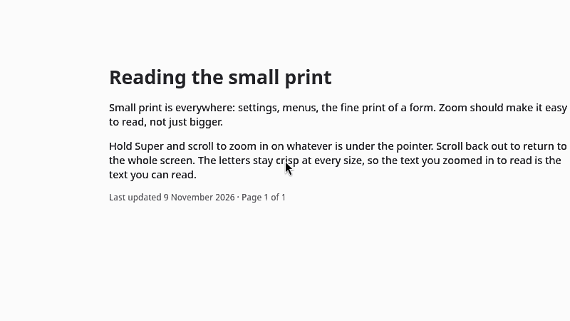
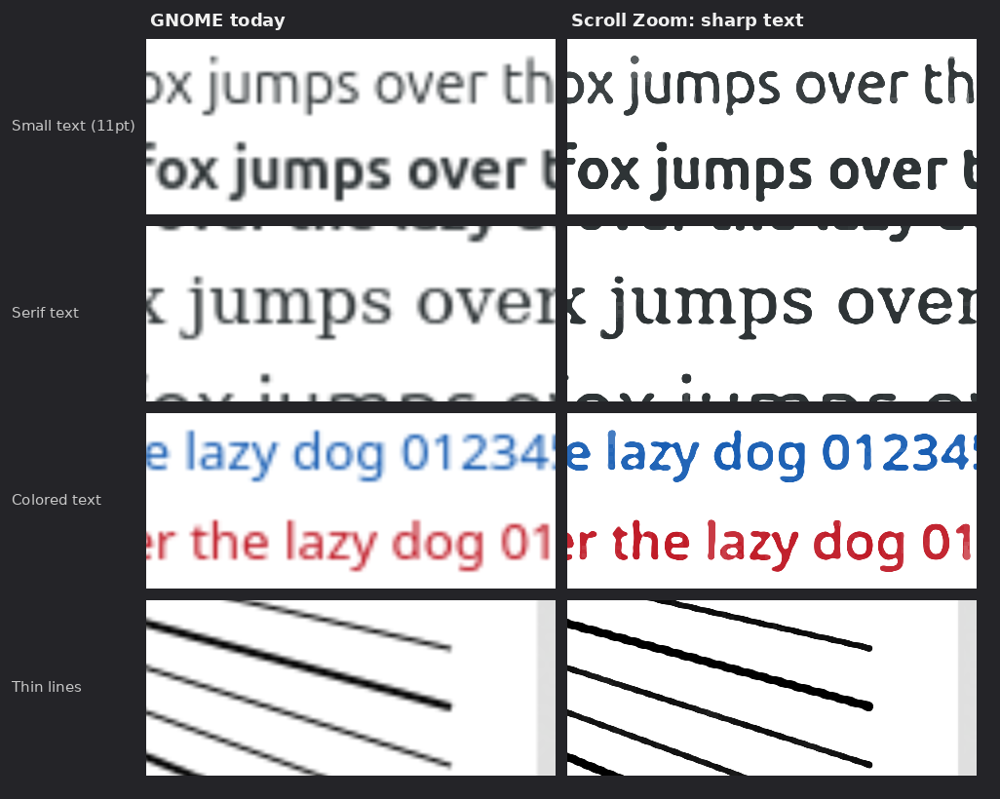

# Scroll Zoom

**Zoom your whole screen the way a Mac does: hold Super and scroll.**

Scroll Zoom is a GNOME Shell extension for anyone who needs a closer look, whether you have
low vision or just want to read small print. Zoom glides smoothly instead of jumping, follows
your pointer, and keeps text sharp instead of blurry.



[**Download Scroll Zoom**](https://github.com/nwmetcal/gnome-scroll-zoom/releases/latest/download/scroll-zoom.shell-extension.zip) ·
[Project page](https://nwmetcal.github.io/gnome-scroll-zoom/) ·
[Report a problem](https://github.com/nwmetcal/gnome-scroll-zoom/issues)

## Why this exists

Scroll Zoom is made by a visually impaired developer who relies on screen zoom every day,
and was tired of zoom tools that fall short on every platform. GNOME's built-in zoom works,
but it jumps between levels, lags behind the pointer on fast displays, and blurs the very
text you zoomed in to read. Scroll Zoom fixes those three things.

## What it does

- **Hold Super and scroll** to zoom in and out around the pointer, with a mouse wheel or a
  touchpad. Zoom all the way out and zoom turns off.
- **Zoom glides** instead of jumping in steps. Spin the wheel faster to zoom faster; on a
  touchpad, a quick swipe coasts to a stop.
- **The zoomed view follows your pointer smoothly**, in step with your display, even at
  144 Hz and above.
- **The view stays where you put it.** GNOME's own zoom jumps to wherever keyboard focus or
  a text cursor moves, even when a terminal prints or a window updates on its own. Scroll Zoom
  keeps the view with your pointer, unless you turn following on.
- **Zoomed text stays sharp.** GNOME's own zoom blurs text as it enlarges it. Scroll Zoom
  redraws letters and lines with crisp, smooth edges, and leaves photos smooth.
- **It works with GNOME's own zoom.** The keyboard shortcuts, the Settings page, color
  effects, and crosshairs all keep working.



## What you need

GNOME 50 on Wayland: for example Ubuntu 26.04 or Fedora 44. To check your version, run:

```bash
gnome-shell --version
```

## Install

1. [Download the extension](https://github.com/nwmetcal/gnome-scroll-zoom/releases/latest/download/scroll-zoom.shell-extension.zip).
   It saves to your Downloads folder.
2. Install it:

   ```bash
   gnome-extensions install --force ~/Downloads/scroll-zoom.shell-extension.zip
   ```

3. **Log out and log back in.** GNOME only loads new extensions when you log in.
4. Open the **Extensions** app and switch on **Scroll Zoom**, or run:

   ```bash
   gnome-extensions enable scroll-zoom@nhicc
   ```

That's it: hold **Super**, the key with the Windows logo on most keyboards, and scroll.

<details>
<summary>Install from the source code instead</summary>

```bash
git clone https://github.com/nwmetcal/gnome-scroll-zoom.git
cd gnome-scroll-zoom
make install
```

Then log out and back in. `make install` switches the extension on for you.

</details>

## How to use it

| Do this | To |
| --- | --- |
| Hold **Super** and scroll up / down | Zoom in / out around the pointer |
| Zoom all the way out | Turn zoom off |
| **Super+Alt+8** | Turn zoom on or off, at the last zoom level you used |
| **Super+Alt+=** / **Super+Alt+-** | Zoom in / out with the keyboard |
| **Super+Alt+\\** | Switch smoothing off (hard pixels) and back on |

These are the same keys macOS uses, with Super in place of Cmd and Alt in place of Option.
Super+Alt+8, = and - are GNOME's own shortcuts; you can change them in **Settings >
Keyboard > View and Customize Shortcuts > Accessibility**.

## Settings

Open them from the **Extensions** app (Scroll Zoom > Settings), or run
`gnome-extensions prefs scroll-zoom@nhicc`.

- **Keys to hold**: Super, Super+Alt, Super+Ctrl, or Super+Shift.
- **Zoom speed**: how far one wheel notch zooms. The default, 1.20, zooms 20% closer.
- **Maximum zoom**: up to 32x.
- **Reverse direction**: scroll down to zoom in.
- **Follow keyboard focus** and **Follow the text cursor**: both off at first, so the view
  stays with your pointer. Turned on, each brings what moved into view as you press Tab or
  type, or as an app moves it, and moves the view only as far as it takes to show it.
- **Smooth images**, and the **Smoothing style**: *Sharp text and lines* (the default),
  *Soft* (smooth everywhere), or *GNOME standard*.

Everything in **Settings > Accessibility > Zoom** applies too, such as how the view
follows the pointer, and color effects. GNOME also has settings for following keyboard focus
and the text cursor, which its Settings page does not show; while Scroll Zoom is on, its two
switches take their place, and turning Scroll Zoom off brings GNOME's back.

## Questions and problems

<details>
<summary><b>Nothing happens when I hold Super and scroll</b></summary>

- Log out and back in after installing; GNOME only loads new extensions at login.
- Check that the extension is running: `gnome-extensions info scroll-zoom@nhicc` should say
  `State: ACTIVE`. If it says `ERROR`, run `journalctl --user -b -g scroll-zoom` and
  [open an issue](https://github.com/nwmetcal/gnome-scroll-zoom/issues) with what it prints.
- If you changed which key drags windows (`org.gnome.desktop.wm.preferences
  mouse-button-modifier`), choose zoom keys in the settings that include that key.

</details>

<details>
<summary><b>Can I use Ctrl and scroll, like on a Mac?</b></summary>

No. On GNOME, a scroll goes straight to the app under the pointer, so GNOME itself only
sees it while the window-drag key, Super, is held. That's also why apps keep their own
Ctrl+scroll zoom.

</details>

<details>
<summary><b>Text looks too bold or too thin, or I want to see the real pixels</b></summary>

Try another **Smoothing style** in the settings, or press **Super+Alt+\\** to switch
smoothing off and see hard pixels. You can fine-tune how bold rebuilt text looks:

```bash
gsettings --schemadir ~/.local/share/gnome-shell/extensions/scroll-zoom@nhicc/schemas \
  set org.gnome.shell.extensions.scroll-zoom edge-position 0.55
```

Above 0.5 draws dark text bolder, below 0.5 thinner. `edge-width` (default 1.0) sets how
soft the edges are, in screen pixels.

</details>

<details>
<summary><b>Does it work on other GNOME versions, or on X11?</b></summary>

It's built and tested on GNOME 50 under Wayland. GNOME switches off extensions that don't
list your version. Support for new versions is added once its tests pass on them.

</details>

<details>
<summary><b>Does it work over full-screen games, video, and virtual machines?</b></summary>

Yes. Its tests zoom over full-screen apps, both newer Wayland apps and the X11 apps most
games are, over apps that take over the keyboard's shortcuts as virtual machines and remote
desktops do, and over apps that keep drawing, as games and video do. Two things to know:

- A game that locks and hides the pointer, as first-person games do, holds the pointer in
  one place, so zoom stays on that spot (usually the middle of the screen) while you look
  around. The tests can't run such a game yet
  ([issue 2](https://github.com/nwmetcal/gnome-scroll-zoom/issues/2)).
- While zoom is on, GNOME draws a full-screen game through its own compositor instead of
  straight to the screen, which can cost a little speed. It goes back to normal when zoom
  turns off.

</details>

<details>
<summary><b>Will it slow down my computer?</b></summary>

Smoothing runs on the graphics card, and only while you're zoomed in. On the computer it's
built on, it keeps a 2560x1440 screen at its full 144 frames a second.

</details>

## Uninstall

```bash
gnome-extensions uninstall scroll-zoom@nhicc
```

## Contributing

Bug reports and ideas are welcome in [issues](https://github.com/nwmetcal/gnome-scroll-zoom/issues).
For working on the code, see [CONTRIBUTING.md](CONTRIBUTING.md).

## License

GPL-2.0-or-later, the license of GNOME Shell. See [LICENSE](LICENSE).
