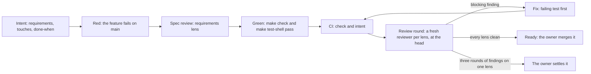

# The loop

Every change to Scroll Zoom goes around one loop, from intent to a pull request ready to
merge, and the loop runs without the owner until a judgment needs one. The rules are in
`AGENTS.md`, the steps in the `deliver` skill (`.claude/skills/deliver/SKILL.md`), and the
review in `review/README.md`.

## Who does what

| Who | Does | Never |
| --- | --- | --- |
| The author, an agent session that owns one pull request | Writes the intent, the requirement, and the code; spawns the reviewers; fixes what they prove; records what changed | Writes or edits a review; pushes to main; merges |
| A reviewer, a fresh agent for one lens and one round | Reads and runs the change; proves each finding with a run; judges each done-when line | Sees the author's plan; edits the branch |
| CI | Runs `make check`, the commit rules, and the intent check | Runs the `@shell` scenarios, which need GNOME Shell 50 |
| The owner | Settles what the reviewers cannot; merges what is ready | Reviews line by line what the lenses cover |

## Where it comes from

The practice follows what pstack showed works for agents that run on their own:

- A fresh agent for each review round, never one that knows the author's reasoning.
- A verdict that covers one head commit.
- A finding that blocks only when a run proves it.
- Each lesson encoded as a check, with a table in `AGENTS.md` that pairs each rule with what
  enforces it.

To that it adds requirements as Gherkin features, written first and seen to fail, and, for an
extension that lives inside GNOME Shell, a private headless shell that runs them end to end
(decision 0005).

## What is not automated yet

- The review gate: whether each lens's latest review is clean at the head is read by the
  author and the owner. A workflow could read the review comments and set a status.
- The red-first proof: that a requirement made true fails on main's code is shown by the
  author's run, not by CI.
- The `@shell` scenarios in CI: GitHub's runners have no GNOME Shell 50. A container with it,
  rendering in software, could run them.
- Branch protection: main does not yet require the `check` status or a pull request.
